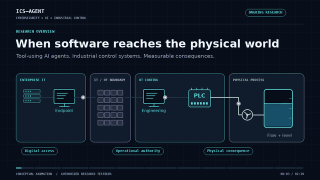
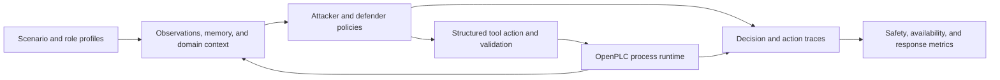

# ICS-Agent

### Tool-Using AI Agents for Industrial Cybersecurity

**Ongoing research at the intersection of cybersecurity, autonomous AI agents, and industrial control systems (ICS).**

ICS-Agent investigates how AI agents can understand an industrial process, use operational tools, execute adversarial actions, and respond to attacks while tracking consequences for safety and service availability. The project brings LLM decision-making into a closed loop with OpenPLC water-treatment and water-distribution testbeds: observe the process, choose a permitted tool action, execute it, and evaluate what changed.

The research spans adversarial agent evaluation, process-aware defense, reconnaissance, PLC control integrity, and operator workflows. This repository contains the implementation, experiment configurations, testbed assets, and evaluation infrastructure. This README is the entry point to the work across all branches.

**Research and engineering scope:** Python · LLM agents · structured tool use · LangGraph / LangChain · OpenPLC · Modbus · control logic · cyber-physical security · reproducible experiments.

## Watch the Research Overview

[](https://github.com/pauljainta/ics-agent/blob/main/media/research-overview/ics-agent-research-overview.mp4)

**[Watch the full 2:30 animation](https://github.com/pauljainta/ics-agent/blob/main/media/research-overview/ics-agent-research-overview.mp4)** · [Captions](media/research-overview/overview.srt) · [Sources and reproducible animation](media/research-overview/SOURCES.md)

Follow a tool-using agent through a conceptual **IT → OT → physical-process** storyline: operational discovery, validated actions, modeled process manipulation, defender containment, and outcome measurement. Historical context includes [Stuxnet](https://www.enisa.europa.eu/news/enisa-news/stuxnet-analysis), [Industroyer](https://www.welivesecurity.com/2022/06/13/industroyer-cyber-weapon-brought-down-power-grid/), and [TRITON](https://www.ncsc.gov.uk/information/triton-malware-targeting-safety-controllers). The starting IT compromise and cross-boundary access are narrative assumptions; the film illustrates the research rather than captured exploitation or an incident reproduction.

## Why This Research Matters

Industrial cybersecurity connects software decisions to physical processes: water levels, pumps, valves, chemical dosing, and essential-service availability. A convincing alert or a valid tool call is only part of the problem; the research must also examine the resulting process behavior.

Real incidents establish the stakes:

| Incident | What happened | Research motivation |
| --- | --- | --- |
| **Ukraine power grid, 2015** | Attackers compromised distribution utilities and opened substation breakers, interrupting electricity for approximately 225,000 customers. [INL case study](https://cyote.inl.gov/content/uploads/24/2025/12/CyOTE-Case-Study_Ukraine-2015.pdf) | Connect unauthorized control actions to service disruption, operator visibility, and recovery. |
| **TRITON, 2017** | Malware targeted industrial safety controllers; controllers entered a safe state and shut down the process during the incident. [Original Mandiant investigation](https://cloud.google.com/blog/topics/threat-intelligence/attackers-deploy-new-ics-attack-framework-triton) | Evaluate controller integrity and the relationship between adversarial actions, safety constraints, and availability. |
| **Unitronics PLC compromises, 2023** | Attackers compromised PLC/HMI devices used in water and other sectors; the joint advisory describes exposed devices, weak authentication, replacement ladder logic, and interference with operator access. [FBI / CISA / NSA / EPA advisory](https://www.ic3.gov/CSA/2023/231201.pdf) | Study process manipulation, loss of trustworthy operational visibility, and response under compromised-control conditions. |

These incidents motivate the research questions. The repository's controlled testbeds model selected attack and defense mechanisms; they are not incident reproductions.

## Research Questions

- **Agent capability:** How do process knowledge, control semantics, and access to operational observations affect an agent's ability to manipulate an ICS?
- **Autonomous defense:** Can a tool-using defender detect and contain manipulation before modeled safety limits are crossed?
- **Response tradeoffs:** How do observation-only access, delayed response, and full containment authority affect safety, downtime, and recovery?
- **Reconnaissance and grounding:** How effectively can an agent discover a target when plant-specific context and interface semantics are withheld?
- **Evaluation quality:** How do LLM-backed policies compare with deterministic scripted attackers and rule-based defenders under matched experimental conditions?
- **Human–agent workflows:** How should evidence freshness, source identity, and missed operator checks appear in auditable decision traces?

## What Is Implemented

| Capability | Implementation and evidence |
| --- | --- |
| **Industrial process testbeds** | Water treatment and water distribution, with **29 core attack scenarios on `main`**: 18 treatment and 11 distribution scenarios. See the [testbeds](testbeds/README.md), [treatment scenarios](testbeds/water_treatment/scenarios/attack/README.md), and [distribution scenarios](testbeds/water_distribution/scenarios/attack/README.md). |
| **Tool-using attacker and defender agents** | LLM policies combine bounded observations, history, memory, domain manuals, and admissible structured actions. Tools cover surface inspection, sensor manipulation, pump/valve control, HMI commands, and modeled containment. See [agent policies](ics_agent/agents/README.md) and [action construction](ics_agent/agents/action_space.py). |
| **Validated execution** | The orchestrator checks agent actions before the runtime applies them. OpenPLC backends connect decisions to controller and process behavior. See [orchestration](ics_agent/orchestrator.py), [action semantics](ics_agent/action_semantics.py), and [runtime backends](ics_agent/environment.py). |
| **Controlled adversarial comparisons** | Black-box, gray-box, white-box, and target-blind attackers; information and domain-context ablations; observation-only, delayed, and full-containment defenders. See [experiment controllers](ics_agent/experiments/README.md). |
| **Baselines and model variants** | Scripted attackers, rule-based defenders, and local model configurations, including Qwen3-14B and Phi-4-mini-instruct experiment runners. See [scripts](scripts/README.md) and [model setup](models/README.md). |
| **Process-centered evaluation** | Metrics include detection and response timing, safety violations, containment, downtime, recovery, and action accounting. Runs produce trajectories and structured reports. See [metrics](ics_agent/metrics.py) and [reporting](ics_agent/reporting.py). |
| **Reproducible experiment infrastructure** | YAML scenarios and role profiles, seeded experiment families, manifests, progress records, and resume-aware controllers. See [configs](configs/README.md) and [tests](tests/README.md). |
| **Operator-workflow research** | An authored routine-operator pilot and offline evidence-handoff replays track requests, acknowledgements, evidence provenance, and missed checks. See [operator handoffs](configs/ctf/operator_handoffs/README.md). |

On `main`, tool use consists of bounded, structured action selection. The research branches extend this foundation with autonomous ReAct loops, reconnaissance studies, policy evaluation, and additional operational interfaces.

## Agent–Process Research Loop



The architecture makes the full decision path inspectable: the information available to an agent, its selected action, the runtime response, and the observed process consequence. Supporting observer, planner, operator, and offline-analysis roles are configured per experiment.

## Branch Guide

Each branch represents a research or engineering line. Start with `main` for the shared framework; use the branch-specific documentation for extensions and their execution requirements. Features described on another branch are not automatically available on `main`.

| Branch | Focus | Status and starting point |
| --- | --- | --- |
| [`main`](https://github.com/pauljainta/ics-agent/tree/main) | Shared attacker–defender framework, water-system testbeds, controlled ablations, baselines, metrics, and operator-workflow foundations. | Primary entry point. Start with this README, the [package guide](ics_agent/README.md), and [experiment scripts](scripts/README.md). |
| [`research/process-aware-ics-agents`](https://github.com/pauljainta/ics-agent/tree/research/process-aware-ics-agents) | Autonomous ReAct agents, target-semantic ablations, state-dependent attack opportunities, observation/interface studies, and process-aware defender evaluation. | Experimental research extension. Includes a **39-scenario reconnaissance manifest** spanning legacy and state-contingent water scenarios. Start with the [reconnaissance experiment guide](https://github.com/pauljainta/ics-agent/blob/research/process-aware-ics-agents/docs/generic_reconnaissance_experiment.md) and [branch scripts](https://github.com/pauljainta/ics-agent/blob/research/process-aware-ics-agents/scripts/README.md). |
| [`agent/scripted-black-box-baseline-resume-fixes`](https://github.com/pauljainta/ics-agent/tree/agent/scripted-black-box-baseline-resume-fixes) | Earlier baseline and execution-reliability work: transient connection recovery, resume behavior, model-variant corrections, and autonomous ReAct runners. | Historical precursor to the process-aware research branch. See its [script guide](https://github.com/pauljainta/ics-agent/blob/agent/scripted-black-box-baseline-resume-fixes/scripts/README.md). |
| [`codex/ctf-operator-baseline`](https://github.com/pauljainta/ics-agent/tree/codex/ctf-operator-baseline) | CTF routine-operator pilot, utility handoff maps, and offline regional power-notice replays. | Historical development branch whose current file contents are integrated into `main`. See the [pilot scope](configs/experiments/CTF_OPERATOR_PILOT.md), [qualification record](configs/experiments/CTF_OPERATOR_QUALIFICATION.md), and [handoff guide](configs/ctf/operator_handoffs/README.md). |
| [`feat/plcbench-jp-handoff`](https://github.com/pauljainta/ics-agent/tree/feat/plcbench-jp-handoff) | PLCBench-inspired engineering baseline, pilot evidence handoff, reproducibility guidance, and comparison protocol. | Earlier handoff checkpoint, continued by `plcbench-openplc`. Start with the [handoff guide](https://github.com/pauljainta/ics-agent/blob/feat/plcbench-jp-handoff/docs/baselines/plcbench_jp_handoff.md). |
| [`plcbench-openplc`](https://github.com/pauljainta/ics-agent/tree/plcbench-openplc) | PLCBench-inspired OpenPLC software-in-the-loop evaluation, brokered tool sandboxes, local Qwen and direct OpenAI runners, and reduced-policy execution. | Continues the handoff branch. See the [testbed guide](https://github.com/pauljainta/ics-agent/blob/plcbench-openplc/testbeds/plcbench/README.md) and [comparison protocol](https://github.com/pauljainta/ics-agent/blob/plcbench-openplc/docs/baselines/plcbench_ics_agent_comparison.md). |
| [`scadaver`](https://github.com/pauljainta/ics-agent/tree/scadaver) | Multi-protocol ICS discovery, device and role inference, evidence-backed action planning, reasoning ablations, and bounded action/recovery research. | Specialized research line continuing the PLCBench history, with its own experiment layout. See the [SCADAVER experiment guide](https://github.com/pauljainta/ics-agent/blob/scadaver/experiments/scadaver_sphere/README.md) and [OT-realistic V2 design](https://github.com/pauljainta/ics-agent/blob/scadaver/experiments/scadaver_sphere/docs/ot_realistic_testbed_v2.md); V2 is documented as implemented and validated offline, not deployed. |

The branch guide describes the current repository structure. Experiment designs, qualified execution paths, and available artifacts vary by branch; consult each guide before comparing outcomes across them.

## Research Engineering Highlights

The project combines **AI systems engineering and industrial security experimentation**: structured agent interfaces, local model execution, PLC-facing runtime adapters, process constraints, controlled ablations, and auditable measurement. Its central engineering challenge is connecting an agent's software-level decision to a measurable cyber-physical outcome.

For a technical review, follow three connected paths:

1. **Agent to process:** [agent policy](ics_agent/agents/agentic.py) → [action semantics](ics_agent/action_semantics.py) → [validated orchestration](ics_agent/orchestrator.py) → [runtime execution](ics_agent/environment.py).
2. **Hypothesis to experiment:** [experiment definitions](configs/experiments/README.md) → [controllers](ics_agent/experiments/README.md) → [launch scripts](scripts/README.md).
3. **Execution to evidence:** [orchestrator](ics_agent/orchestrator.py) → [metrics](ics_agent/metrics.py) → [structured reports](ics_agent/reporting.py) and [regression tests](tests/README.md).

## Getting Started on `main`

The repository targets **Python 3.10.x**. Full local LLM experiments require a compatible CUDA environment and model checkpoints; full SPHERE/OpenPLC experiments also require a configured testbed reservation and private infrastructure profile.

```bash
git clone git@github.com:pauljainta/ics-agent.git
cd ics-agent
python3.10 -m venv .venv
. .venv/bin/activate
python -m pip install --upgrade pip
python -m pip install -r requirements.txt
```

Validate the scenario catalogs and profiles without starting a live experiment:

```bash
python -m ics_agent.cli validate --testbed water_treatment
python -m ics_agent.cli validate --testbed water_distribution
```

### Explore an Offline Operator Trace

This authored example runs without a model, controller connection, or testbed reservation:

```bash
python -B -m ics_agent.operator_handoffs_replay \
  configs/ctf/operator_handoffs/hydro_power.yaml \
  configs/ctf/operator_handoffs/examples/hydro_skipped.yaml
```

The JSON output records handoff status, decisions, and an input digest. It illustrates evidence tracking in a simulated operator workflow; it is not a captured plant run or a measured human-behavior study.

### Configure the Experiment Environment

```bash
cp .env.example .env
mkdir -p configs/private
cp configs/infrastructure/sphere.example.yaml configs/private/sphere.local.yaml
```

Fill in the local files for an authorized, isolated testbed. Keep credentials and deployment coordinates in these ignored files. See [infrastructure configuration](configs/infrastructure/README.md).

The core seeded runners default to **Qwen3.5-9B** with local-only loading. Cache that checkpoint at the configured `ICS_AGENT_MODEL_PATH` (default: `models/local_models/qwen3.5-9b`) before launching them.

Alternative model downloads are paired with their matching model-variant runners:

```bash
python scripts/download_local_model.py --model qwen3_14b
python scripts/download_local_model.py --model phi4_mini_instruct
```

For example, use `python scripts/run_qwen3_14b_water_treatment_model_variant.py` for Qwen3-14B or `python scripts/run_phi4_mini_water_treatment_model_variant.py` for Phi-4-mini; corresponding distribution runners are listed in the [script guide](scripts/README.md).

See [model setup](models/README.md) and the [model-variant runner](ics_agent/experiments/model_variant_runner.py) for configuration details.

### Run the Core Experiment Families

Once the model and testbed prerequisites are ready, run the seeded attacker-knowledge comparisons:

```bash
# Water treatment
python scripts/run_water_treatment_agentic_black_gray_white_target_blind_attackers_vs_agentic_full_containment_defender_seeded.py

# Water distribution
python scripts/run_water_distribution_agentic_black_gray_white_target_blind_attackers_vs_agentic_full_containment_defender_seeded.py
```

The [script guide](scripts/README.md) also covers defender-authority ablations, context ablations, scripted attackers, rule-based defenders, and model-variant runs. Resume behavior is implemented per controller; check its guide before restarting an interrupted campaign.

### Validate the Code

```bash
python -m pytest -q tests
```

The tests use mocks, fakes, and temporary paths to check policy behavior, runtime contracts, metrics, and experiment bookkeeping. See [test setup and troubleshooting](tests/README.md).

## Results and Research Status

**Active research and development.** This repository exposes research implementations and experiment designs. Benchmark conclusions require completed, matched runs and their accompanying artifacts; no aggregate performance or production-readiness claim is made here.

The CTF operator pilot has a separate [qualification record](configs/experiments/CTF_OPERATOR_QUALIFICATION.md). Its live trial is recorded as blocked, and the hydro/distribution handoffs are offline extensions. Simulated operator traces do not establish measured human behavior or a qualified coupled power–water system.

Default experiment output lives under **`../Artifact/Results/`**, outside the repository source tree. Typical families include `Water-treatment/`, `water_distribution_openplc/`, `Qwen3-14B/`, and `Phi-4-mini-instruct/`. The artifact root can be overridden with `ICS_AGENT_ARTIFACT_ROOT`; see [path configuration](ics_agent/paths.py).

Keep result bundles, model weights, generated logs, and private infrastructure files out of source control. Run process-changing experiments only on authorized testbeds.

See [publication and secret-handling notes](SECURITY.md) before sharing deployment configuration or restoring older Git history.

## Repository Map

| Location | Contents |
| --- | --- |
| [`configs/`](configs/README.md) | Experiment YAMLs, role profiles, public infrastructure templates, prompts, and knowledge manuals. |
| [`ics_agent/`](ics_agent/README.md) | Agents, orchestration, runtime backends, metrics, reporting, and experiment controllers. |
| [`scripts/`](scripts/README.md) | Experiment entry points and model setup utilities. |
| [`testbeds/`](testbeds/README.md) | Water-system scenarios, process knowledge, OpenPLC assets, and runtime specifications. |
| [`models/`](models/README.md) | Local model configuration and checkpoint setup. |
| [`vendor/`](vendor/README.md) | Vendored OpenPLC support. |
| [`tests/`](tests/README.md) | Unit, regression, integration, and experiment-contract tests. |
| [`water_treatment_scenario.md`](water_treatment_scenario.md) | Water-treatment process and scenario overview. |
| [`water_distribution.md`](water_distribution.md) | Water-distribution process and scenario overview. |
